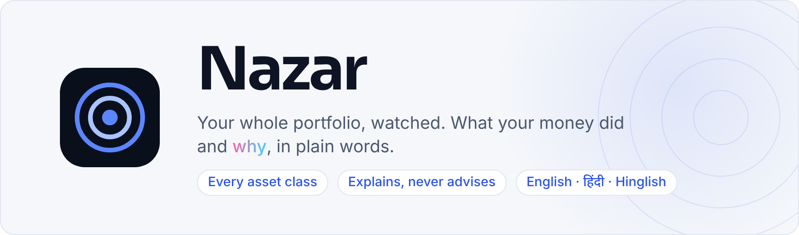
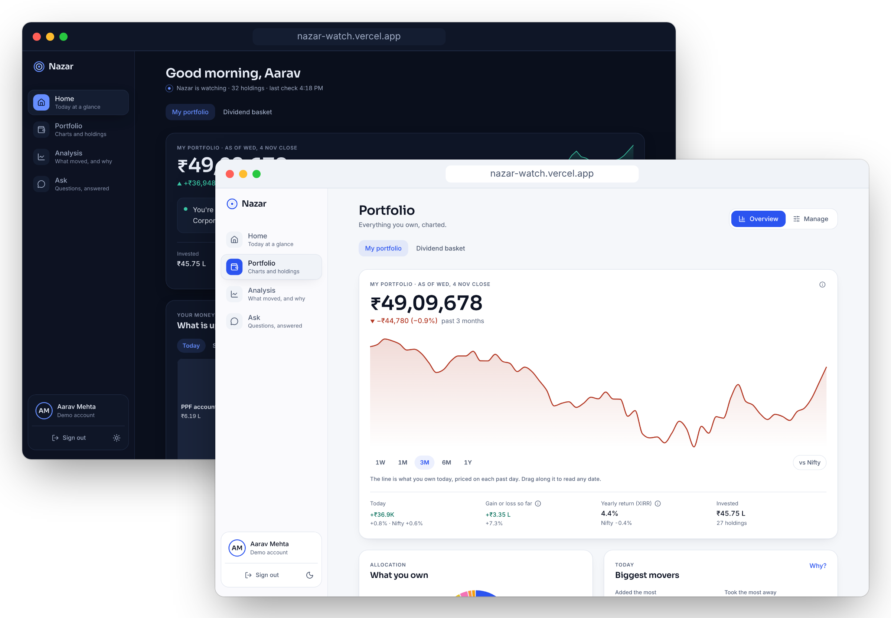
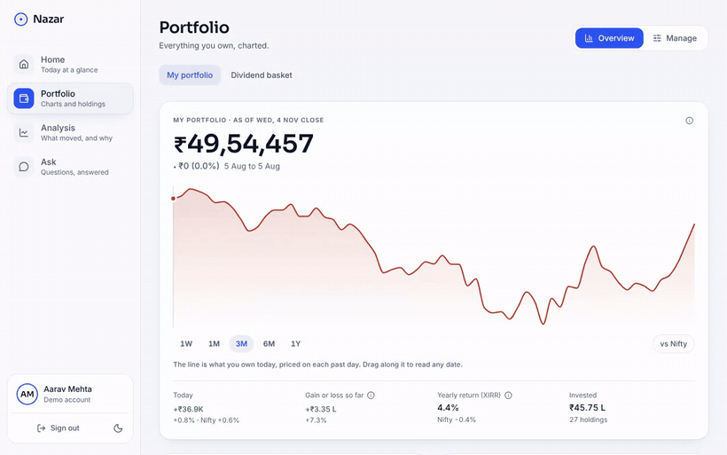
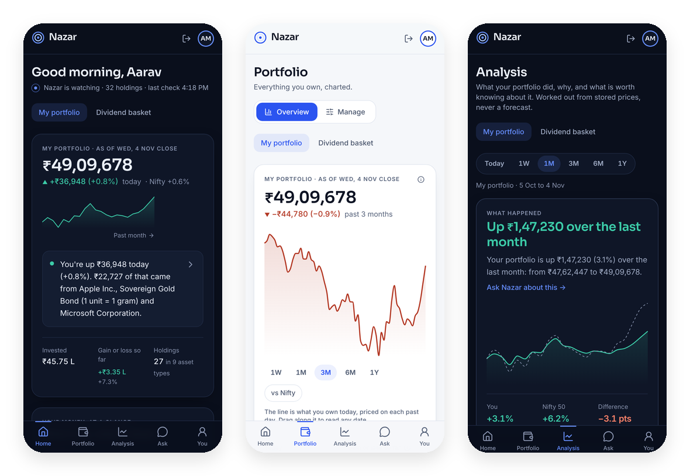
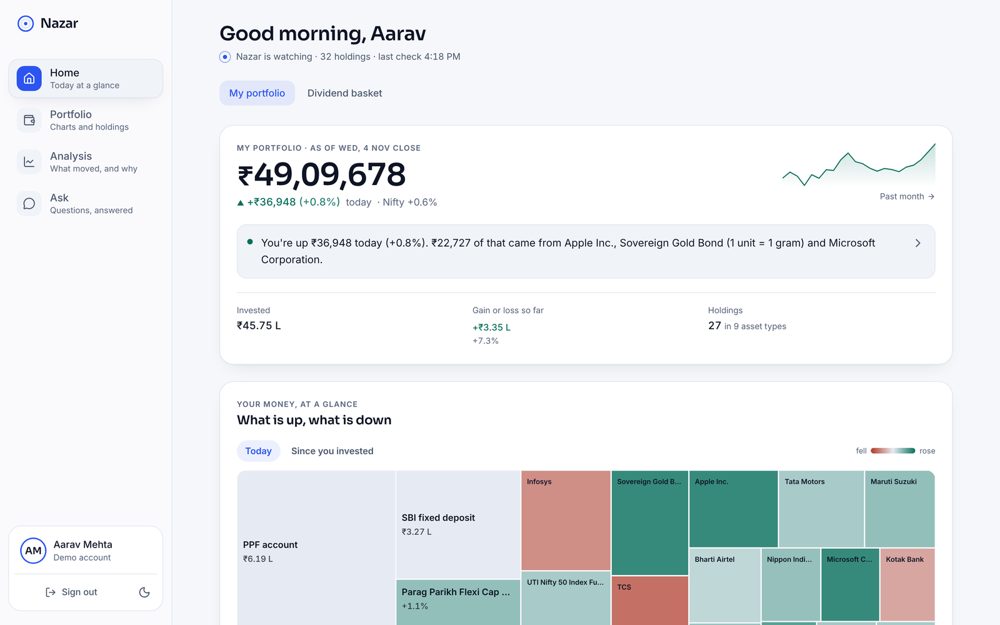
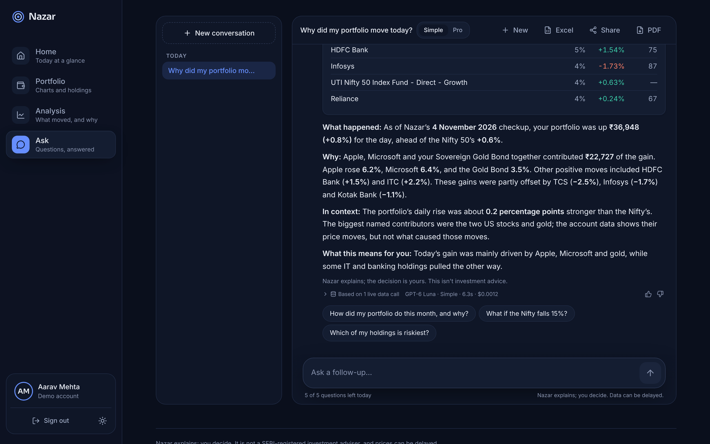
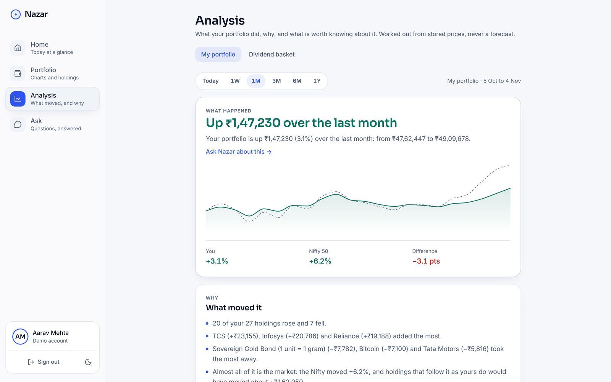
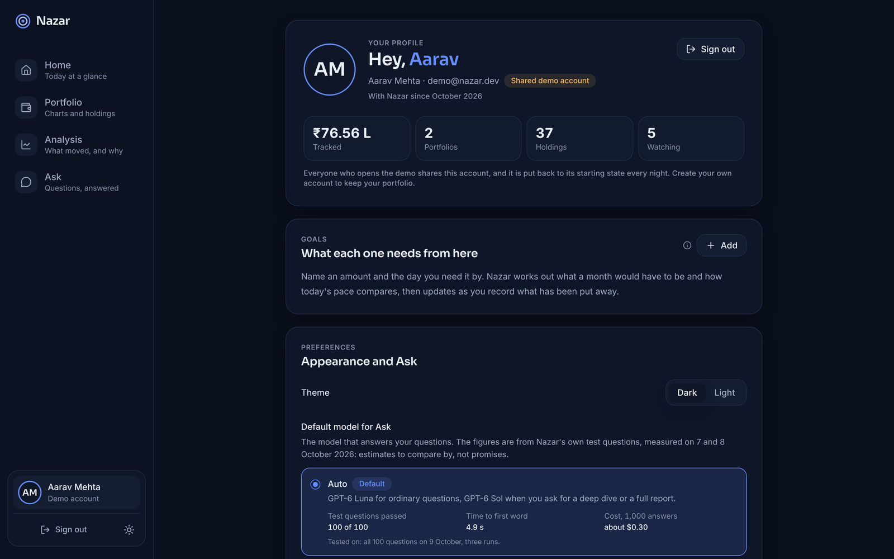
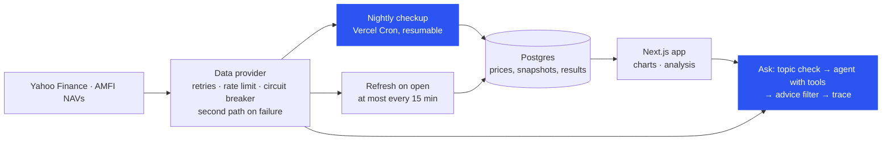

<p align="center">
  <picture>
    <source media="(prefers-color-scheme: dark)" srcset="assets/readme/banner-dark.png">
    
  </picture>
</p>

<p align="center">
  <a href="https://github.com/sakshamm21/Nazar/actions/workflows/ci.yml"></a>
  
  
  
</p>

<p align="center">
  <b>Nazar tracks everything you own</b> (stocks, mutual funds, ETFs, gold, US stocks, crypto, deposits)<br>
  and explains what your money did and why, in plain words.<br>
  <i>It explains; you decide.</i>
</p>

<p align="center">
  <a href="https://nazar-watch.vercel.app"></a>
  &nbsp;
  <a href="#run-it-locally"></a>
</p>

<p align="center">
  
</p>

<p align="center"><sub><b>Earlier version:</b> <a href="https://stockai-legacy.vercel.app">StockAI (legacy)</a>, on the <a href="https://github.com/sakshamm21/Nazar/tree/legacy"><code>legacy</code></a> branch.</sub></p>

## See it in action

<p align="center">
  <picture>
    <source media="(prefers-color-scheme: dark)" srcset="assets/readme/demo-dark.gif">
    
  </picture>
  <br>
  <sub>Drag along the value chart to read any day, then switch the period. Everything is priced from stored data.</sub>
</p>

## Features

- **Everything you own, in one place.** Stocks, mutual funds, ETFs, REITs, gold and silver,
  US stocks, crypto, deposits, PPF, EPF, NPS, bonds, property and cash.
- **Today in one sentence.** Your value, what changed, and which holdings did it.
- **Analysis from arithmetic.** What moved, why, how much was simply the market, and how you
  did against the Nifty. Reproducible and tested, never a forecast.
- **Import in a minute.** Holdings files from Zerodha, Groww and Upstox, and CAMS / KFintech
  mutual fund statements.
- **SIPs and goals.** Monthly SIPs added at each day's price, and savings goals that show what
  they need every month.
- **All your portfolios together, or one at a time.** A stock held in two portfolios is one
  position in the combined view.
- **Sales, income and tax years.** Record a sale at its price and date, or a dividend; see what
  was realised and paid out, and every sale of a financial year by the rules it follows.
- **Dashboards.** Build your own comparisons: everything, your funds, your stocks or one
  holding against the Nifty or a sector index, on as many dashboards as you like.
- **Ask.** An AI research assistant with 30 tools, in English, Hindi or Hinglish, that can read
  your portfolio and never change it.
- **No advice, enforced.** A test fails the build if anything tells you what to buy, sell or hold.
- **Free to run.** Free market data, free-tier hosting, and capped model spend.

<p align="center">
  
  <br>
  <sub>On a phone: Home, Portfolio and Analysis.</sub>
</p>

## Contents

1. [Why Nazar](#why-nazar)
2. [Try it in a minute](#try-it-in-a-minute)
3. [Screens](#screens)
4. [How it works](#how-it-works)
5. [Tech stack](#tech-stack)
6. [Project structure](#project-structure)
7. [Design](#design)
8. [Test accounts](#test-accounts)
9. [Run it locally](#run-it-locally)
10. [Testing](#testing)
11. [Deploy your own](#deploy-your-own)
12. [Disclaimer](#disclaimer)

## Why Nazar

Retail investors in India hold money in many places: a broker or two, a few mutual funds, gold, a PPF account, an FD. They can see prices everywhere, and still cannot answer simple questions:
- how much do I have in total, and how did it do this month?
- which holdings caused that, and how much was just the market?
- am I as diversified as I think?

Nazar puts everything in one place, keeps the prices fresh on its own, and answers those questions in sentences. It never tells anyone what to buy, sell or hold. An automated test enforces that on everything the app writes, and a filter enforces it on everything the AI assistant writes.

## Try it in a minute

1. Open the live app and press **Try the demo**. It gives you a private, full account for 24 hours: 14 stocks plus funds, ETFs, a REIT, gold, US stocks, Bitcoin and deposits, and a second smaller portfolio.
2. **Home** is the glance: your value, today's change in one sentence, and a map of every holding coloured by how it moved.
3. **Portfolio → Overview**: drag along the value chart, tap the allocation ring, sort the holdings table. **Manage** is where you add, change or remove holdings and portfolios, and set up a monthly SIP.
4. **Analysis**: pick a period and read what moved, why, and how it compares with the Nifty; then returns, unsold gains, risk and health.
5. **Ask** a question about your portfolio, a company or the market.
6. **You**: set a savings goal and choose the model Ask uses.

Signing in is required. See [the test accounts](#test-accounts) below.

## Screens

<table>
  <tr>
    <td width="50%"></td>
    <td width="50%"></td>
  </tr>
  <tr>
    <td align="center"><sub><b>Home</b>: your value, today's change in one sentence, and a heatmap</sub></td>
    <td align="center"><sub><b>Ask</b>: answers from your portfolio and live data, with sources</sub></td>
  </tr>
  <tr>
    <td width="50%"></td>
    <td width="50%"></td>
  </tr>
  <tr>
    <td align="center"><sub><b>Analysis</b>: what moved, why, and against the Nifty</sub></td>
    <td align="center"><sub><b>You</b>: profile, savings goals and the model Ask uses</sub></td>
  </tr>
</table>

| Screen | What it does |
|---|---|
| **Home** | With more than one portfolio, opens on all of them together. Total value with today's change, one sentence on what caused it, and a heatmap of every holding: bigger tile, more of your money; green rose, red fell. |
| **Portfolio · Overview** | A value chart you can drag through (1 week to 1 year, against the Nifty), your yearly return (XIRR) beside the Nifty's, an allocation ring, today's biggest movers, sector mix, a health summary and a sortable table of every holding. |
| **Portfolio · Manage** | One search across stocks, ETFs, mutual funds, REITs and InvITs, gold and silver, US stocks and crypto; add several at once, or add deposits, PPF, EPF, NPS, bonds, property and cash at the value you enter. Record a later purchase on any holding, kept as its own lot, a sale at its price and date (taken from the oldest purchases first and kept after the holding is gone), or a dividend or interest paid. Each holding's History lists every purchase, sale and payout, and one wrong purchase can be taken out on its own. Create, rename and delete portfolios (up to six), and keep a "Watching" list. |
| **Dashboards** | Named dashboards of your own comparisons. Each card is something you own (everything, the market-linked part, one kind of asset, or one holding; from all portfolios or one) against the Nifty 50 or a sector index, over a month to a year, with both lines starting at 100. A new account starts with whole portfolio, market-linked, funds and stocks against the Nifty. |
| **Capital gains by year** (`/analysis/taxes`) | Every recorded sale in an Indian financial year, each part by the rules it follows and how long it was held, with the tax at those rates (with cess, at your slab if you give it), the year's dividends and interest, and an Excel download. |
| **Monthly SIPs** | Set a SIP on any holding: an amount and a day of the month, starting today or in the past. Nazar adds each instalment at that day's price, catches up on the months already gone, and lets you pause, stop or undo it. |
| **Import** | A holdings file from Zerodha, Groww or Upstox (CSV/Excel), or a mutual fund statement from CAMS / KFintech (PDF). Rows are matched by ISIN first, so renamed companies still resolve. For a name no rule can match, a model suggests candidates, each checked against the NSE list, for you to pick or skip. |
| **Analysis** | Pick a period (today to a year): what the portfolio did, which holdings did it, how much was simply the market, and how the ride went against the Nifty. Below that: what stands out right now, gains and losses since you invested, what your unsold gains would count as under the rules for each kind of asset (short-term or long-term from each purchase's own date, the exemption, and the tax with cess, at your slab if you give it), a stress test, concentration, hidden clusters of holdings that move together, and the health of what you own. |
| **Stock page** | Price history, risk and return, key metrics, and the latest quarter explained: what improved and what got worse. Downloads as an Excel model. |
| **Ask** | An AI research assistant with 30 tools over live market data and read-only access to your portfolio, SIPs and goals. It answers in English, Hindi or Hinglish, in Simple or Pro mode, and shows how each answer was built and where its data came from. Conversations are saved, export to one Excel workbook (the DCF, comps and risk models keep their formulas), and can be shared by a link that leaves your own holdings out. Every tool is listed with an example at `/ask/research`. |
| **You** | Your profile and what you track at a glance; savings goals (up to eight), each showing what it needs every month from here and whether today's pace reaches it; your income-tax slab (optional); Ask as Quick or Thorough, with every model's scores, cost and speed one link away; theme (both saved to your account); a weekly email and notifications on this device, both off until switched on; which portfolio the app opens on; a download of everything you entered; password change, sign out and account deletion. |
| **Insights** (admin only, `/insights`) | Product numbers for the owner: people who track a portfolio and came back this week, the path from sign-up to reading the analysis, which screens are used, what people track, Ask's quality (what the checks on each answer found, which tools failed, how one prompt version compares with another) and cost, and whether the market data is current. |

Nazar sends email for the code that confirms your address and a password reset link, and, only if you switch it on, a weekly summary every Saturday with a one-click unsubscribe. Home also says what changed since you last looked. The [privacy](https://nazar-watch.vercel.app/privacy) and [terms](https://nazar-watch.vercel.app/terms) pages say what is stored and who else sees it.

## How it works



- **Pages never call the market-data provider.** Each evening the checkup fetches the data for everything someone holds once, stores a snapshot, and computes beta and a financial-health score from the stored data. Pages read only from the database, so they are fast and keep showing the last known prices when a data source is down.
- **Built for free-tier limits.** Vercel's free plan runs each cron job once a day and stops functions at 300 seconds. So the checkup is a resumable state machine: it keeps a lock, a cursor and a 240-second budget, and three evening runs each continue where the last one stopped. Every write is idempotent, so a re-run never duplicates anything.
- **Every asset class from free sources.** Exchange-traded assets come from Yahoo; mutual fund NAVs from AMFI's daily file (history from mfapi.in); gold and silver per gram from the international price and USD/INR plus import duty; US stocks and crypto from Yahoo's dollar price converted to rupees at the day's rate. Deposits, provident funds, property and cash are valued at what you enter, plus interest at the rate you give.
- **A second path when the first one fails.** Yahoo's API is unofficial: it rate-limits, and its session flow breaks. When it misses a listed symbol, the checkup asks a second endpoint that needs no session and is served from two hosts. Where that has no price either, the last stored one is kept; a price is never guessed.
- **Refresh on open.** Opening the app makes one batched quote call for that user's holdings, at most every 15 minutes, stored exactly as the nightly checkup stores it.
- **Analysis from arithmetic, not a model.** The value history prices what you hold today on each past day. A period's change is split by holding and by asset type, and into "the market" (each holding's start value × its beta × the Nifty's move) and "specific to what you own". The sentences are fixed templates over those numbers, so every one is reproducible and tested. Purchases and sales along the way are not replayed, and the screens say so.
- **Returns from when the money went in.** Each purchase, including every SIP instalment, is stored as a lot with its own date and price. The yearly return (XIRR) places each rupee on the day it was invested and each sale on the day it happened, and unsold gains are sorted into short-term and long-term from each lot's age, under the rules for what it is (shares and equity funds, gold ETFs, US stocks and physical gold, debt funds, crypto).
- **Splits and bonus issues.** The nightly checkup reads them for held shares and restates each purchase made before the ex-date in new shares, so a split never looks like a loss.
- **No advice, enforced.** A guard with English, Hindi and Hinglish patterns checks every generated sentence and every string in the interface, in a test that fails the build. A narrower filter removes any sentence in an Ask answer that tells the reader what to do with their money, as the answer streams.
- **No captured or hand-written market data.** The test accounts are ordinary accounts on the same live sources as everyone else; only their choice of holdings is written down.

- **Functions run next to the database.** The free Neon database is in AWS us-east-1, so Vercel functions run in `iad1` too. A page pays the long hop to India once per request instead of once per query.
- **One rupee view.** Everything is held and shown in rupees. A US stock or a coin is converted at the day's dollar rate, so its value here moves with both its price and the rupee.
- **Updates only on request.** The weekly email and device notifications (results from companies you hold, SIP instalments added) are off until switched on, built from the same tested sentences, and checked by the advice guard before they go. Notifications need a VAPID key pair (see `.env.example`).
- **Deliberately not built.** Price alerts and family reports (an earlier version had them; they were removed in favour of the Analysis screen), analyst ratings and target prices (they are recommendations), and live intraday prices (a daily tracker, not a trading screen).

### How Ask answers

A model is used in two places only: Ask, and the suggestions for import rows that nothing else can match (only the names are sent, never quantities or prices). Everything else is arithmetic.

- **One request path.** The conversation is loaded from the database, limits and budgets are checked, a small model decides whether the question is on topic, and the agent answers with tools scoped to the signed-in user. Tests and evals call the same function the app does.
- **Read ahead.** When the wording plainly needs the user's portfolio, or names one company on the NSE list, that lookup is made before the model runs and handed to it, which saves a model call and about two seconds.
- **Bounded.** An answer stops looking things up after a fixed number of steps, 30 seconds or $0.10, and then has to answer. Each user has a per-minute and per-day limit and a daily spending cap, and the whole app has one too.
- **Read-only on the portfolio.** Ask can read holdings, SIPs and goals and can never change them. The only tools that write add to or remove from the Watching list, and they are offered only when the message asks for that.
- **Every answer is checked and traced.** Code checks run on each live answer: is it in the language of the question, does every number trace to a tool result, was a sentence removed as advice. The result is stored with the tools called, the timings, the cost and the prompt version, and readers can mark an answer helpful or not.
- **A model chosen by measurement.** Models are reached through OpenRouter and earn their place by their score on Nazar's own questions (see [Evaluating Ask](#evaluating-ask)). The default is the one that scored highest, which was also the cheapest. Three open-weight models are offered beside it, and a deployment can run them on a server of its own, so that questions go to no AI company.
- **Changes to the prompt go out gradually.** A new wording can be given to a fixed share of users first; Insights then shows its flags, speed, cost and ratings beside the current one.

## Tech stack

| Area | Choice |
|---|---|
| App | Next.js 16 (App Router), React 19, TypeScript |
| UI | Tailwind CSS 4 with design tokens, motion, Recharts, lucide icons. Fonts: Sora, Inter, IBM Plex Mono, Noto Sans Devanagari |
| Data | PostgreSQL with Drizzle ORM: Neon in production, PGlite (Postgres in WebAssembly) for local development and tests |
| Market data | Yahoo Finance via `yahoo-finance2` with a second chart-endpoint path, AMFI NAVs, mfapi.in, the NSE equity and ETF lists, Google News RSS |
| Auth | Email and password (bcrypt), a 6-digit email code, a signed session cookie (JWT); a password change signs every other device out |
| Email | Brevo HTTP API (free tier) |
| AI | Vercel AI SDK 7, with models reached through OpenRouter (or OpenAI directly, or an OpenAI-compatible server of your own) |
| Files | ExcelJS for imports and Excel models, unpdf for mutual fund statements |
| Jobs | Vercel Cron |
| Testing | Vitest (unit and integration), Playwright (end to end), an eval harness for Ask |
| CI | GitHub Actions: type check, lint, tests and build on every push |
| Hosting | Vercel |

Running cost is zero apart from light model use in Ask, which has per-answer, per-user and daily spending caps.

## Project structure

```
src/
  app/                    Pages and API routes (Next.js App Router)
    (app)/                Signed-in app: home, portfolio, analysis, risk, stock, ask, settings
    (auth)/               Sign in, sign up, verify, forgot and reset password
    api/                  JSON API, the Ask stream, and the cron jobs
    s/                    Shared Ask conversations (public, read-only)
    insights/  design/    Admin product numbers, and the live style guide
    page.tsx              Landing page
  components/             UI by area (home, portfolio, analysis, ask, goals, landing, …) plus shared ui/, rings/, charts/
  lib/
    portfolio/            Portfolio maths: P&L, XIRR, purchase lots, SIPs, goals, capital gains, performance over a period, and the sentences that describe them
    analytics/            Quant models: health score, beta, correlation, comps, DuPont, SIP, technicals
    pipeline/             The nightly checkup: collect, refresh on open, first look for new stocks
    data/                 Market-data provider (Yahoo) with retries, rate limiting, a circuit breaker and a second path
    market/               Reading stored prices and snapshots for a portfolio and a day
    instruments/          Asset classes, sectors, and the search lists behind one search box
    importers/            Broker file parsers (Zerodha, Groww, Upstox), mutual fund statements (CAMS / KFintech PDF), symbol resolution and suggestions
    demo/                 Test accounts (personas on live data)
    ask/                  The Ask assistant: request path, tools and their registry, prompt, topic check, advice filter, read-ahead, traces, model catalog
    auth/  email/  db/    Accounts and sessions, email templates and sending, schema and connection
    repo/  views/         Data access per user, and view models for pages
  data/                   Search lists: NSE equities, ETFs, REITs and InvITs, and AMFI mutual fund schemes
drizzle/                  Database migrations
scripts/                  Local dev, migrations, local reset, pipeline run, list refresh
evals/                    The Ask eval harness: labelled cases, graders, recorded market data, the baseline, and the model-comparison report
tests/
  unit/                   Pure logic: maths, lots, SIPs, goals, capital gains, importers, Ask's guards and checks, auth, contrast, no-advice
  integration/            Real SQL on in-memory Postgres: pipeline, authorization, test accounts, assets, lots, SIPs, goals, Ask, insights
  e2e/                    Browser click-through of every hero flow
```

## Design

Dark ink-navy by default with a porcelain light theme, a cobalt accent, and a pink-to-cyan gradient kept for the one word or number that matters on a screen. Concentric rings, after the *nazar* amulet, are the only brand shape, and each one has a job:
- the logo;
- the portfolio-health gauge (outer ring: financial health, inner ring: diversification);
- the "Nazar is watching" status;
- loading states;
- calm empty states;

Type has two voices: Sora for headings and Inter for text and numbers, with IBM Plex Mono for tickers. Every colour is a token in `src/app/globals.css`, tested for WCAG AA contrast in both themes. The layout is mobile-first with bottom tabs, and gains and losses always carry a sign and an arrow, never colour alone. The live style guide is at `/design`.

## Test accounts

Signing in is required. **Try the demo** on the landing and sign-in pages gives each visitor a private copy of the investor below for 24 hours, so nobody sees anyone else's changes. The accounts below sign in through the form (password `nazar123` for all) and are shared.

| Account | What it holds |
|---|---|
| `demo@nazar.dev` · Aarav, the investor | 14 stocks, three mutual funds, two ETFs, a REIT, a Sovereign Gold Bond, Apple, Microsoft, Bitcoin, an FD, PPF and EPF; plus a second portfolio, "Dividend basket" (stocks, a fund, jewellery, a post office deposit, savings) |
| `riya@nazar.dev` · Riya, the saver | Five mutual funds, three ETFs, a REIT, gold, silver, a US index fund, Ethereum, three stocks, an FD, PPF, EPF, NPS, a bond and an emergency fund |
| `tester1@nazar.dev` · Kabir | A separate copy of the investor |
| `tester2@nazar.dev` · Meera | A separate copy of the saver |
| `new@nazar.dev` · Isha | Empty, for building a portfolio from scratch |

Things to know:
- They run on live data like any account: prices refresh when you open the app and every evening.
- Each has about 45 sessions of stored price history, so charts and analysis have something to show from the first visit.
- They are shared, and put back to their starting state once a day. A private demo is cleared once its 24 hours are up.
- The personas come with savings goals, a monthly SIP and one recorded sale (priced at that day's stored close), so every screen has something to show.
- Their names and passwords can't be changed, they can't be deleted, and they never send email.
- A demo visitor gets a smaller daily allowance of Ask questions than a signed-up user.

## Run it locally

Requires **Node.js 22 or newer**. The same commands work on Windows, macOS and Linux.

```bash
npm install
npm run dev
```

Open http://localhost:3000 and press **Try the demo**.

No database or API keys are needed, only an internet connection. Without a database URL, `npm run dev` creates an embedded Postgres in `.data/nazar`, applies the migrations, and builds the test accounts from live market data (about a minute the first time). To enable optional features, copy `.env.example` to `.env.local`:

| Feature | Variable |
|---|---|
| Ask tab, and import suggestions | `OPENROUTER_API_KEY` (or `OPENAI_API_KEY`) |
| Real email (sign-up codes and password resets) | `BREVO_API_KEY`, `MAIL_FROM` |
| The `/insights` page | `ADMIN_EMAILS` (or `INSIGHTS_KEY`) |
| Open-weight models on your own server | `SELF_HOSTED_BASE_URL`, `SELF_HOSTED_MODELS` |

Every variable is documented, one per line, in `.env.example`.

### Commands

| Command | What it does |
|---|---|
| `npm run dev` | Run the app locally with the test accounts |
| `npm test` | Unit and integration tests (782 tests, about a minute) |
| `npm run test:e2e` | Playwright click-through of every hero flow, on its own database |
| `npm run lint` · `npm run typecheck` | ESLint and TypeScript checks |
| `npm run demo:reset` | Rebuild the local database and test accounts (stop `npm run dev` first) |
| `npm run pipeline:run` | Run the nightly checkup now, against live market data |
| `npm run db:generate` | Create a migration after changing `src/lib/db/schema.ts` |
| `npm run nse:refresh` · `npm run catalog:refresh` | Refresh the search lists: NSE equities, and ETFs, REITs and mutual funds |
| `npm run eval:agent` | Score Ask's answers on labelled questions: right tools, right language, no advice, numbers traced to data. **Spends model credit** |
| `npm run eval:guard` · `npm run eval:import` | Measure the topic check, and the import suggestions, on labelled cases. **Spend model credit** |
| `npm run eval:regrade` | Re-score saved answers with the graders as they are now. Free |
| `npm run eval:calibrate` | Compare a judge model's verdicts with your own blind labels. Free |
| `npm run eval:harvest` | Turn flagged or down-voted answers from the test and admin accounts into candidate cases. Free |
| `npm run eval:archive` | Add new eval runs to the report's data. Free |

The three commands that spend credit are locked: each runs only with `NAZAR_ALLOW_MODEL_SPEND=1` set in the shell for that one command. Tests, the build, deploys and the nightly checkup never call a model.

## Testing

- **Unit tests** cover the logic that decides what users are told:
  - broker file parsing, mutual fund statements (PDF) and symbol resolution;
  - portfolio maths and the quant models; purchase lots, SIP instalments, goals and capital gains;
  - Ask's pure parts: the advice filter, the read-ahead, the tool registry, shared links, model routing and the eval graders themselves;
  - the news relevance filter and the retry, circuit-breaker and second-path logic;
  - sessions and signed links;
  - WCAG AA contrast of every colour token in both themes.
- **Integration tests** run the real SQL on an in-memory Postgres:
  - the full nightly checkup against a fake market, including re-runs, market holidays, new results and a provider outage;
  - authorization through the real API routes: another user's data always returns 404 and is never changed;
  - the test accounts: built on a fake live market, holding every asset class, put back nightly, with copies that never share state;
  - lots, SIPs and goals through their API routes;
  - the whole Ask request path on a scripted model, with no key and no network: limits, the topic check, tools, the advice filter, traces and what Insights reports.
- **The no-advice test** checks every generated sentence (the day's explanation, the analysis, results, emails) and every user-visible string in the code.
- **End-to-end tests** drive a real browser through the landing page, the demo, Home, both Portfolio tabs (including creating, renaming and deleting a portfolio, and starting and undoing a SIP), Analysis, Ask, goals, choosing Ask's model, the profile, sign-up with a broker import and the mobile tabs.
- **CI** runs the type check, lint, the unit and integration suites and a production build on every push and pull request, with no secrets.

### Evaluating Ask

Tests show the request path works; they cannot show whether a model's answers are good. That is measured separately, in `evals/`:

- **Cases.** 100 labelled questions, each run three times: 70 that users ask (portfolio, company, market, learning, the app, multi-turn) and 30 adversarial ones (pressure for advice, instructions planted in a tool result, prompt leaks, privacy, off-topic in disguise), in English, Hindi and Hinglish. Four more cover deep dives, and the topic check has 81 of its own.
- **A fixed world.** Every case goes through the real request path. Only two things are swapped: the portfolio is a fixed one, and market data is replayed from recordings, so two runs differ only in what the model did.
- **Graders in code decide.** Right tools called, answer in the question's language, within length, no sentence that directs the reader, and every number traced to a tool result. Judge models are reported beside them and decide nothing until calibrated against a person's labels.
- **A baseline in the repository.** `evals/baseline.json` holds the last accepted run (100 of 100 cases), and a new run is compared against it case by case.
- **The model was chosen this way.** Ten models were scored on the same cases. The cheapest scored highest, the one tuned for finance scored lowest, and the best open-weight models came within two or three cases. The method, every result and what is not yet known are in [`evals/report/MODEL_EVAL_DRAFT.md`](evals/report/MODEL_EVAL_DRAFT.md), a working draft, with the raw data for each run beside it.

## Deploy your own

1. Create a free Postgres database (for example on Neon) and a free Brevo account with a verified sender.
2. Import the repository on Vercel and set at least `NAZAR_DATABASE_URL`, `AUTH_SECRET`, `CRON_SECRET`, `BREVO_API_KEY`, `MAIL_FROM` and `OPENROUTER_API_KEY`.
3. Deploy. The build applies migrations and builds the test accounts from live data. `vercel.json` schedules the nightly checkup (weekday evenings IST) and the nightly maintenance.

Optional: `ADMIN_EMAILS` opens `/insights`; `ALLOWED_MODELS` and `ASK_AUTO_MODEL` choose which models Ask offers and which one it uses by default; the limits and budgets for Ask are in `.env.example`.

## Disclaimer

Nazar is not a SEBI-registered investment adviser and never tells you what to do with your money. Market data comes from Yahoo Finance and AMFI and may be delayed or occasionally wrong. Figures on capital gains describe what the rules would make of a gain today; they are not tax advice.
